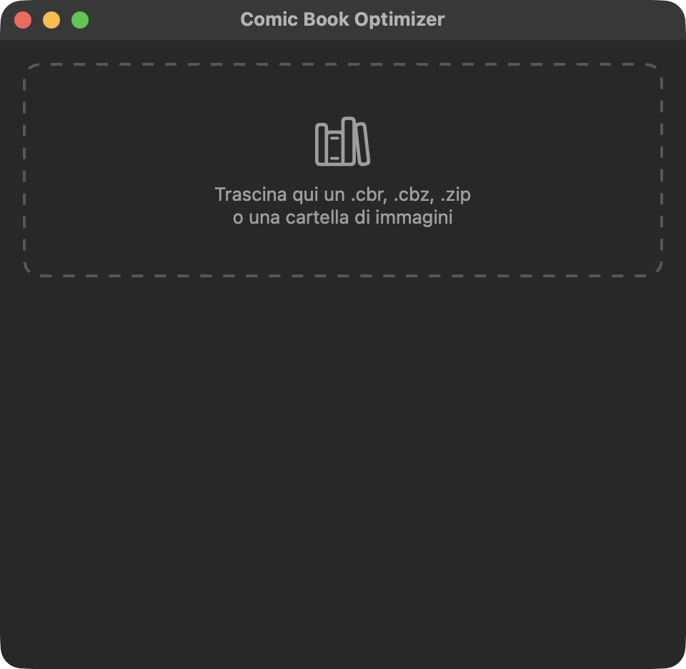

<p align="center">
  
</p>

<h1 align="center">Comic Book Optimizer</h1>

<p align="center">
  Prepares comic book archives for reading on an iPad with Panels.<br>
  A native SwiftUI app for macOS, built on the <a href="https://www.libarchive.org">libarchive</a> and ImageIO frameworks that ship with the system.
</p>

<p align="center">
  
</p>

## Features

- **Drop and go**: drag one or more `.cbr`, `.cbz`, `.cb7`, `.zip`, `.rar`, `.7z`, `.pdf` files or folders of images onto the window. Items are processed one after the other and the log fills in below the drop zone.
- **Reading direction**: before starting, pick "Occidentale (sinistra → destra)" or "Manga (destra → sinistra)". In manga mode the pieces of a cut page are written right to left.
- **Preview carousel**: every page of the book is shown with a filmstrip of thumbnails in their real aspect ratio, so spreads and oddities stand out. Flip with the arrow keys, click a thumbnail to jump, mark pages to throw away with "Elimina questa pagina" (adverts, scan targets, duplicate covers), then press Return to continue.
- **Automatic classification**: each page is compared with the median aspect ratio of the book itself. About 1× is a normal page, about 2× is a double-page spread, anything else (three-panel foldouts, crooked scans, banners) is out of format.
- **Redundant spread removal**: when a spread's two halves already exist as adjacent single pages, the spread is dropped without asking. Halves are matched with a 64-bit difference hash, so it works even when the halves are stored at a different resolution.
- **Page editor**: every spread and out-of-format page stops on an editor. Drag the white handles to crop, add as many vertical cuts as you need with "Aggiungi taglio" (a spread arrives with the cut already placed in the middle), drag cuts to adjust them, and page through the neighbours with the arrow keys to see the context. Pinch or use the magnifier buttons to zoom up to 8× and drag to pan.
- **Three outcomes per page**: "Applica" writes the pieces, "Tieni invariata" keeps the page as is, "Elimina pagina" drops it.
- **Resize for iPad**: pages larger than 2048×2732 pixels (iPad Pro 12.9" native resolution) are scaled down to fit. Pages that already fit keep their original bytes and extension, so an untouched JPEG is never re-encoded.
- **JPEG output**: resized pages and cut pieces are encoded as JPEG at 81% quality, the same value as the ImageOptim slider.
- **Optional ImageOptim pass**: if ImageOptim is installed in `/Applications`, a "Rifinisci con ImageOptim" toggle appears and the staged files are run through it with its own saved preferences.
- **Stored CBZ next to the original**: the result is written as `Name.cbz` beside the input, or `Name (ottimizzato).cbz` if that name is taken. Entries are named `001.jpg`, `002.jpg`, … and stored uncompressed, since JPEGs don't deflate.
- **Keep or trash originals**: at the end the app asks "Conservare i file originali?". "Sposta nel Cestino" moves the inputs to the Trash and, when possible, renames the output to the plain name.

## Requirements

- macOS 13 or later to run the app. The icon is a Liquid Glass icon rendered at runtime on macOS 26; older systems get the flat `.icns` fallback.
- Xcode 26 or later to build: the Swift 5.9 toolchain for the package and `actool` for the icon, which is compiled with a macOS 26 deployment target.
- No third-party dependencies. `libarchive` (zip, rar, rar5 and 7z reading, zip writing) is already in macOS, and the app links against the system dylib with its own minimal header in [Sources/CArchive/include/carchive.h](Sources/CArchive/include/carchive.h). Image decoding, scaling and JPEG encoding go through ImageIO and CoreGraphics.
- [ImageOptim](https://imageoptim.com) is optional. Install it with `brew install --cask imageoptim`; it is only used when present and when the toggle is on.

## Installation

```bash
git clone https://github.com/giuliomaffei90/comic-book-optimizer.git
cd comic-book-optimizer
./bundle.sh
```

[bundle.sh](bundle.sh) quits any running instance, compiles the package in Release, assembles `Comic Book Optimizer.app` inside `.build/`, renders [AppIcon.icon](AppIcon.icon) into the bundle with `actool` (an `Assets.car` for Liquid Glass plus a flat `AppIcon.icns` fallback), writes the `Info.plist`, signs the bundle ad hoc, copies it to `~/Downloads` and launches it from there. SwiftUI needs a real bundle to behave like an app, which is why a plain `swift run` is not enough.

The self-check builds a synthetic comic and verifies the archive round trip, spread detection, redundant-spread removal and manga page order:

```bash
swift run ComicOptimizer --selftest
```

For development, open the package in Xcode:

```bash
open Package.swift
```

## How it works

1. The drop zone in [App.swift](Sources/ComicOptimizer/App.swift) keeps the dropped URLs that are folders or have an archive or `pdf` extension, then shows the reading-direction sheet. "Ottimizza" starts a detached task that runs the pipeline on each item in turn.
2. [Pipeline.swift](Sources/ComicOptimizer/Pipeline.swift) loads the pages: an archive is read entirely into memory by `readArchive` in [Archive.swift](Sources/ComicOptimizer/Archive.swift), a PDF is rendered by `readPDF` page by page with CoreGraphics at 2732 pixels tall (so spreads keep their full width) and encoded as JPEG at 81%, a folder is enumerated recursively. Only files with an image extension (`jpg`, `jpeg`, `png`, `webp`, `gif`, `bmp`, `tif`, `tiff`, `heic`, `avif`) count, dotfiles and `__MACOSX` entries are skipped, and the names are sorted with Finder-style natural ordering.
3. Every page is decoded and hashed, then the pipeline suspends until the carousel in [PageCarousel.swift](Sources/ComicOptimizer/PageCarousel.swift) returns the set of pages to discard. "Annulla" aborts the whole item.
4. The remaining pages are classified against the median aspect ratio, whatever it is: a book whose pages share one format, even landscape, has nothing to cut. Within 25% of 1× is normal, within 30% of 2× is a spread, the rest is out of format. For each spread, the hashes of its two halves are compared with the two pages before and the two pages after it; a Hamming distance of 12 bits or less on both halves marks the spread redundant.
5. Normal pages pass through. For every other page the pipeline suspends again on the editor in [PageEditor.swift](Sources/ComicOptimizer/PageEditor.swift), which hands back a decision: keep, drop, or replace with the cropped pieces between the cuts. Pieces narrower or shorter than 8 pixels are discarded, and in manga mode the order is reversed.
6. Each output page is scaled with `fit` in [ImageOps.swift](Sources/ComicOptimizer/ImageOps.swift) and encoded as JPEG only when it was resized or cut, then staged in a temporary folder. If requested, ImageOptim is launched on those files and the pipeline waits for it to exit.
7. `writeCBZ` writes a stored zip to the output path chosen by `outputURL`, the log reports the final size, and once every item is done the keep-or-trash alert appears.

## Known limitations

- The interface is in Italian only. There is no localisation table, the strings live in the source.
- The drop zone text mentions only `.cbr`, `.cbz`, `.zip`, `.pdf` and folders, but `.cb7`, `.rar` and `.7z` are accepted too.
- PDF pages are rasterised, not extracted: the original embedded images are never passed through untouched, and every page goes through one JPEG encode.
- A book made mostly of spreads (e.g. a PDF of facing pages) takes the spread as its norm, so the spreads pass through uncut and only the odd portrait pages stop on the editor.
- Cuts are vertical only, so a page stacked top to bottom cannot be split.
- The whole archive and every decoded page are held in memory for the duration of the job. Very large books use a lot of RAM.
- Page order comes from file names only. Archives whose pages are numbered inconsistently will be ordered as Finder would sort them.
- Nested archives inside an archive are ignored, and the output is always a `.cbz` regardless of the input format.
- A resized PNG page is written as JPEG, because the only encoder is the JPEG one.
- The ImageOptim pass is synchronous: the app waits until ImageOptim exits, and uses whatever preferences ImageOptim has saved.
- The main window has a fixed size of 480×440 points, while the carousel and the editor open as large sheets of at least 900×720 and 1000×780 points.
